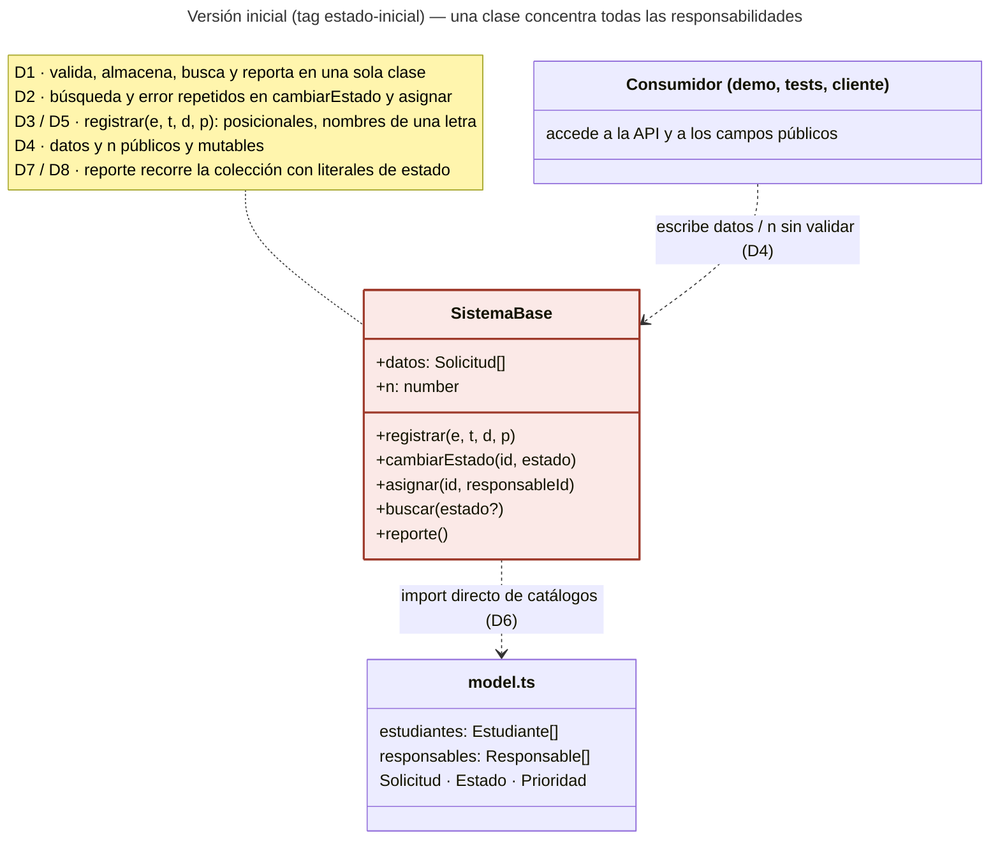
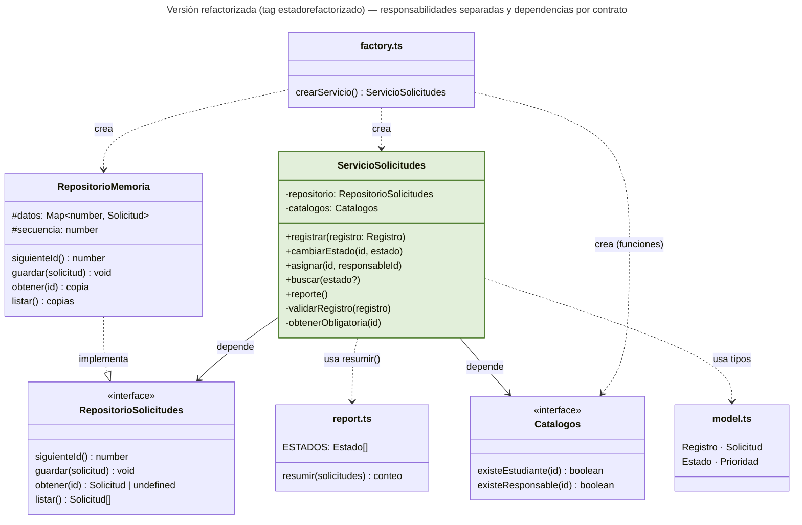

# Diagramas de clases (Mermaid)

Fuentes editables: diagrama-antes.mmd y diagrama-despues.mmd. GitHub muestra los bloques de abajo como diagramas.

## Versión inicial (estado-inicial)

## Versión refactorizada (estadorefactorizado)

